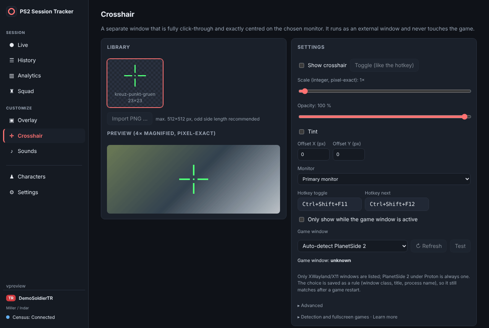
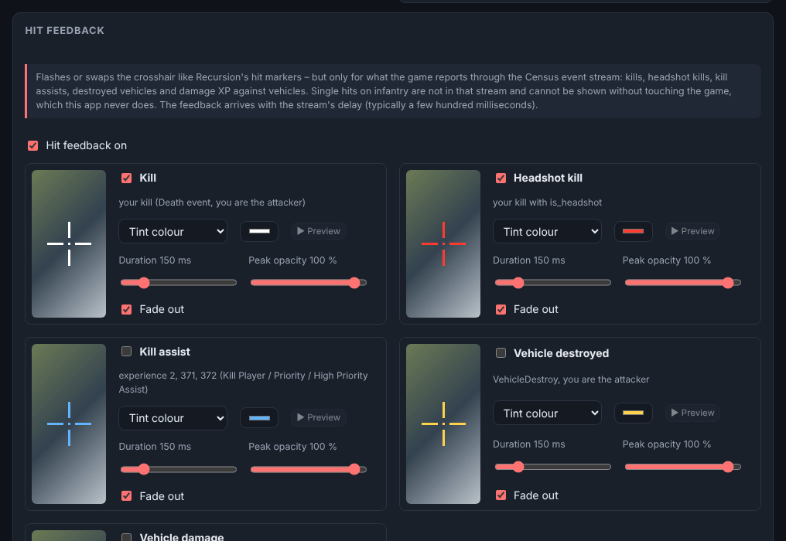

# Crosshair

A separate, transparent, click-through window exactly in the centre of the
monitor – it does not change the game.

- **Own PNG**, pixel-exact, exactly centred, scaling, opacity, tint, X/Y
  offset, monitor, hotkeys (see [Hotkeys](Hotkeys)); optionally only while the
  game is active.
- **Own PNGs** – also templates from the web – can be added at any time with
  *Crosshair → Import PNG* (up to 512×512).

## Built-in crosshairs

Generated in code (`crosshair.rs`, CC0, pixel-exact without anti-aliasing):
dot, cross and circle, plus `cross` in three sizes (32, 24, 12 px; 2 px bars,
the large ones with a gap in the middle), `cross-dashed` and `dot`, each in
green, magenta and red with a light dark outline, and the range ladder
`range-ladder` in orange for 1440p and 4K (line with dots, diamond in the
middle, below it a ladder with 1–9; the spacing is a guide, not calibrated to a
weapon). The crosses with 2 px bars have an even side length; their centre lies
between two pixels, like the centre of a monitor with an even resolution.

New built-in crosshairs are added to the library at the next start; existing
files stay unchanged. As files:
`cargo run -p ps2-tracker-core --example crosshair_dump -- <folder>`.

## Only while the game is active

*Only show while the game window is active* hides the crosshair while another
window is in front. Which window counts as the game is set under **Game
window**: *Auto-detect PlanetSide 2* (default) or a window picked from the list
of open windows (*Refresh* updates it, *Test* reports whether a matching window
is found). The choice is saved as a rule (window class, title, process name),
not as a window ID, so it still matches after a game restart. The line *Game
window: active / in background / not running / unknown* shows the current
state. The same picker appears on the Overlay page when the overlay is set to
show only with the game.

Under X11/XWayland the app reads `_NET_ACTIVE_WINDOW`, `WM_CLASS` and the
window title (under Proton PlanetSide 2 reports itself as `steam_app_218230`);
on Windows the foreground window and its process name. Only XWayland/X11
windows are listed; PlanetSide 2 under Proton is always one. The crosshair is
hidden only when another window is certainly active; if the detection is
uncertain, it stays visible. *Game window → Advanced* has the match pattern
for auto-detection (`WM_CLASS` or title, `|` separates) and *Check active
window*, which shows the detected state and window backend; the log has it
too. Under KDE Plasma see also
[Overlay and Move Mode](Overlay-and-Move-Mode#kde-plasma-wayland).

## Hit feedback

*Crosshair → Hit feedback*: the crosshair briefly lights up in a colour or
switches for a moment to another PNG from the library – per event with duration
(default 150 ms), fade, opacity peak and preview.

**Limits, honestly:** the Census API and the event stream provide **no hit or
damage events** for infantry, only deaths, vehicle destructions and experience.
Single hits would only be visible in the game itself – which the app never
touches. The triggers are therefore:

| Event | Source | Default |
|---|---|---|
| Kill | Death event, you are the attacker | on, white |
| Headshot kill | the same with `is_headshot` | on, red |
| Kill assist | experience 2, 371, 372 (Kill Player / Priority / High Priority Assist) | off |
| Vehicle destroyed | VehicleDestroy, you are the attacker | off |
| Vehicle damage | experience “… Damage (Infantry vs Vehicle)” or “… Damage” (25 IDs, listed in `hitfx.rs`) | off |

Own death, suicide and teamkill trigger nothing. The feedback comes with the
delay of the event stream (typically a few hundred milliseconds); the log gives
the time since the ESS timestamp per effect (`crosshair feedback … delay_ms`;
the timestamp has a resolution of one second). Only the content of the
crosshair window is drawn – size, position and window type stay the same.
