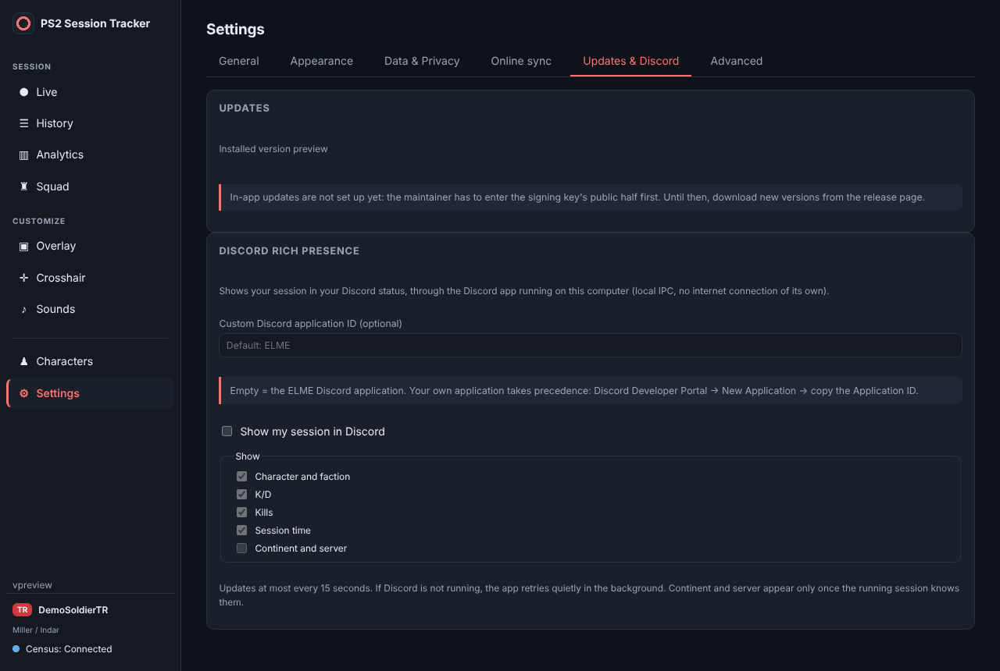

# Discord Rich Presence

Shows your running session in your Discord status: character and faction, K/D,
kills, session time and optionally continent and server. Off by default.

## Setup

1. *Settings → Updates & Discord* → tick **Show my session in Discord**.
2. **Custom Discord application ID (optional):** leave the field empty
   (placeholder *Default: ELME*) to use the ELME Discord application built into
   official builds. Your own application takes precedence: Discord Developer
   Portal → *New Application* → copy the *Application ID* (17–20 digits); other
   input is rejected. Self-built versions have no default: there the field
   says *Required in this build*, and without an own ID the feature stays off.
3. Choose what to show (character and faction, kills, session time, continent
   and server).

## How it works

- Connection **only locally** to the running Discord app (Unix socket
  `$XDG_RUNTIME_DIR/discord-ipc-N`, on Windows the named pipe
  `\\.\pipe\discord-ipc-N`); the app opens no internet connection of its own
  for this.
- Updates at most every 15 seconds. If Discord is not running, the app retries
  quietly with a growing interval (up to 5 minutes).
- Continent and server appear only once the running session knows them.
- The default is the ELME Discord application, the same one the
  [online sync](Online-Sync) signs in with (`PS2_SYNC_DISCORD_CLIENT_ID` at
  build time). Its ID is a public client ID, not a secret, but the app does not
  show it: not in the field, not in the log and not in `config.toml`. An empty
  field means "default", so the default can change with an update without
  touching your configuration; a stored copy of the default is cleared at
  start, your own ID is kept.
- Flatpak: only `xdg-run/discord-ipc-0` and `xdg-run/discord-ipc-1` are
  allowed. That reaches a natively installed Discord. Whether it reaches the
  Discord Flatpak (its socket lives under `xdg-run/app/com.discordapp.Discord/`)
  has not been verified; if not, allow that folder for this app, e.g. with
  Flatseal or `flatpak override --user
  --filesystem=xdg-run/app/com.discordapp.Discord:create dev.herz.Ps2Tracker`.

Details: [Permissions and Privacy](Permissions-and-Privacy#discord-optional-local).
