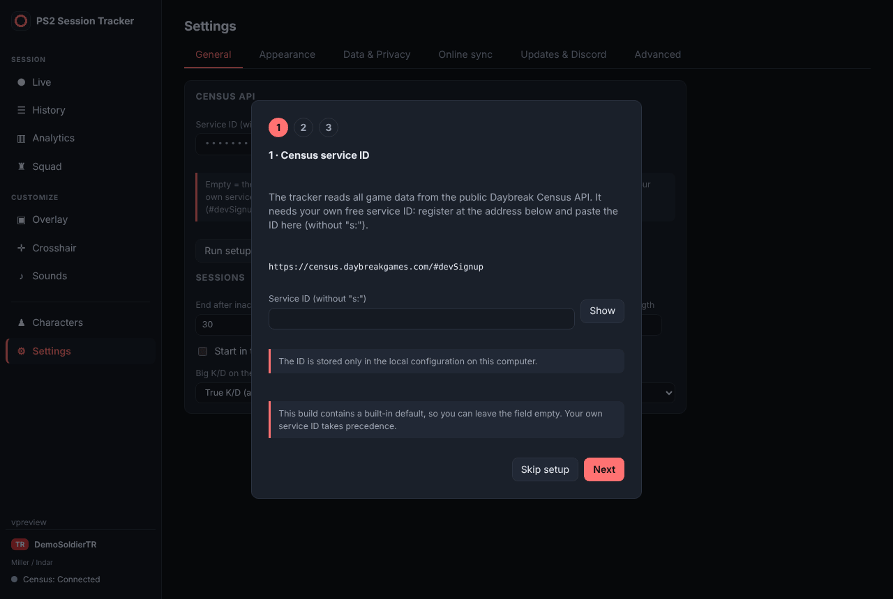

# Getting Started

## First start

After the [installation](Installation) the first-start assistant opens with
three steps:

1. **Census service ID** – official builds contain a built-in default, so the
   field can stay empty; your own ID takes precedence (see below).
2. **Your character** – search a character by name and add it. More
   characters (e.g. one per faction) can be added later under *Settings*.
3. **Ready** – optionally import a voice pack or pick a crosshair.

From then on a **session starts automatically** when you log in or with your
first kill or death, and ends at logout or after inactivity. If you log back
in within 15 minutes (e.g. after a game crash), the same session goes on. The live page
shows the running session; finished sessions are in *History* (see
[Sessions, Analytics and Export](Sessions-Analytics-and-Export)). Buttons on the
live page start and end a session by hand, resume a paused one at once, and
open the last session again (*Resume last session*, up to 6 hours after it
ended).

Next steps: [Overlay and Move Mode](Overlay-and-Move-Mode),
[Crosshair](Crosshair), [Voice Packs](Voice-Packs), [Hotkeys](Hotkeys).

## Census service ID

The Census API needs a service ID. Which one the app uses, in this order:

1. the environment variable `PS2_SERVICE_ID` (never written to the file),
2. your own ID from **Settings → Census API** (without `s:`; stored in the
   local configuration),
3. the built-in default of official builds,
4. `example` (only very few requests possible).

**Official builds contain a project service ID.** It is embedded at build time
(GitHub Actions secret, not in the repository) and can be read from the binary.
It grants no access to any account; Daybreak uses it only to attribute requests
to this app and for rate limiting. The app never shows it, never logs it and
never writes it to the configuration – Settings only says “built-in default”.
You can enter your own ID at any time; register for free at
<https://census.daybreakgames.com/#devSignup>. Leave the field empty to go back
to the default. Builds from source have no built-in default
(`PS2_DEFAULT_SERVICE_ID` at compile time, letters, digits and `_` only) and use
`example` until you enter an ID.

## Configuration and data

| What | Path (Linux) |
|---|---|
| Configuration (also through the UI) | `$XDG_CONFIG_HOME/ps2-tracker/config.toml` |
| Own achievements | `$XDG_CONFIG_HOME/ps2-tracker/achievements.toml` |
| Own sound triggers (whole rule set) | `$XDG_CONFIG_HOME/ps2-tracker/triggers.toml` |
| Conditions changed in the user interface | `config.toml`, `[voice.trigger_overrides]` |
| Sessions and name cache | `$XDG_DATA_HOME/ps2-tracker/tracker.sqlite3` |
| Voice packs | `$XDG_DATA_HOME/ps2-tracker/voicepacks/` |
| Crosshairs | `$XDG_DATA_HOME/ps2-tracker/crosshairs/` |
| Log (current run, previous one as `.log.1`) | `$XDG_STATE_HOME/ps2-tracker/ps2-tracker.log` (usually `~/.local/state/ps2-tracker/ps2-tracker.log`) |

On Windows everything is under `%APPDATA%\ps2-tracker\`, in Flatpak under
`~/.var/app/dev.herz.Ps2Tracker/`. Templates:
`crates/ps2-tracker-core/assets/achievements.default.toml` and
`triggers.default.toml` (in the Arch package under `/usr/share/ps2-tracker/`).
How to remove all data: [Permissions and Privacy](Permissions-and-Privacy#deleting-data).
