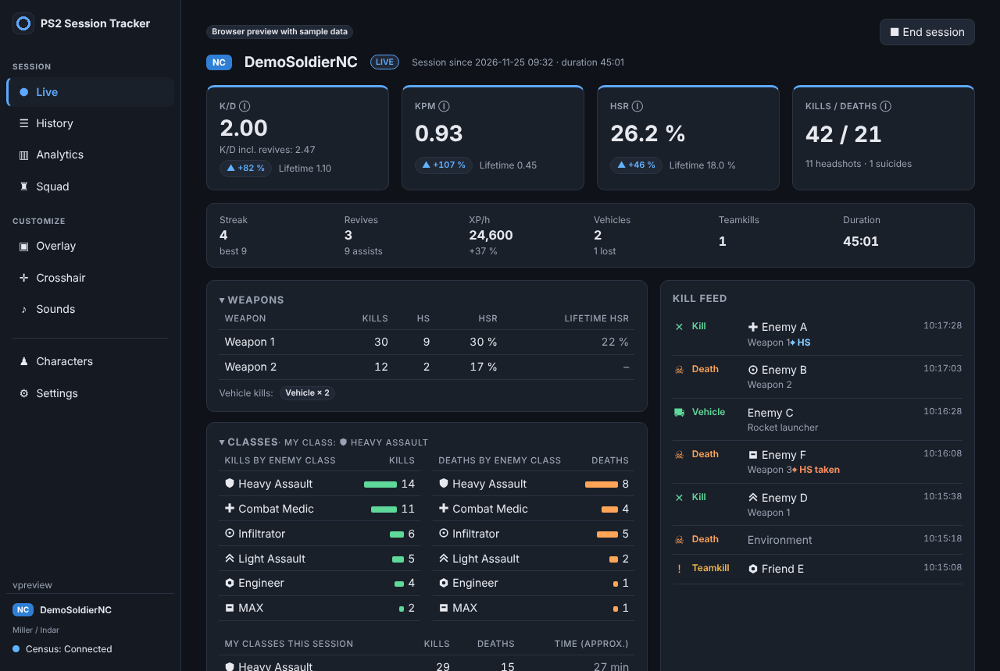

# PS2 Session Tracker – Wiki

Session stats, overlay, crosshair and voice packs for **PlanetSide 2** on Linux
(CachyOS/Arch, AppImage, Flatpak) and Windows.

> **Does not touch the game.** No injection, no hooks, no memory reading, no
> Vulkan layer. All game data comes from the public **Daybreak Census API**
> (REST and event streaming over WebSocket). Overlay and crosshair are separate,
> external windows.

## Start here

- [Installation](Installation) – packages for Arch, AppImage, Flatpak and Windows
- [Getting Started](Getting-Started) – first start, characters, Census service ID
- [Troubleshooting and FAQ](Troubleshooting-and-FAQ) – logs, debug mode, known issues

## Features

- [Sessions, Analytics and Export](Sessions-Analytics-and-Export) – live stats,
  kill feed, classes, history, charts, Excel/JSON/CSV
- [Overlay and Move Mode](Overlay-and-Move-Mode) – in-game overlay, move layer,
  KDE/Wayland, OBS browser source
- [Crosshair](Crosshair) – pixel-exact crosshair window and hit feedback
- [Voice Packs](Voice-Packs) – sounds, Recursion packs, conditions
  ([format reference](Voice-Pack-Format))
- [Squad and Outfit Tracking](Squad-and-Outfit-Tracking) – friends and outfit
  members, “Squad top 3”
- [Discord Rich Presence](Discord-Rich-Presence)
- [Online Sync](Online-Sync)
- [Auto-Update](Auto-Update) – signed in-app updates (opt-in)
- [Hotkeys](Hotkeys) – global hotkeys and command line

## Security and privacy

- [Permissions and Privacy](Permissions-and-Privacy) – every network
  connection, file and permission, with the source code location
- [Security](Security) – reporting vulnerabilities, signatures, supply chain

## Development

- [Building from Source](Building-from-Source)
- [Contributing](https://github.com/Elementary-Beginnings/ps2-tracker/blob/main/CONTRIBUTING.md)
- [Release process](https://github.com/Elementary-Beginnings/ps2-tracker/blob/main/docs/release.md)

The wiki is generated from
[`docs/wiki/`](https://github.com/Elementary-Beginnings/ps2-tracker/tree/main/docs/wiki)
in the repository; changes go through pull requests there.
