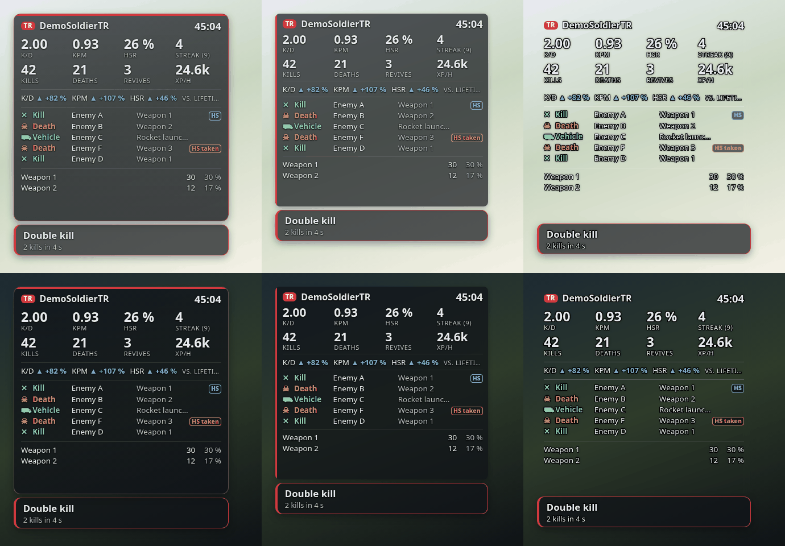
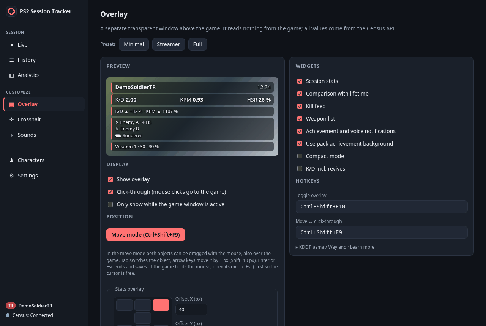
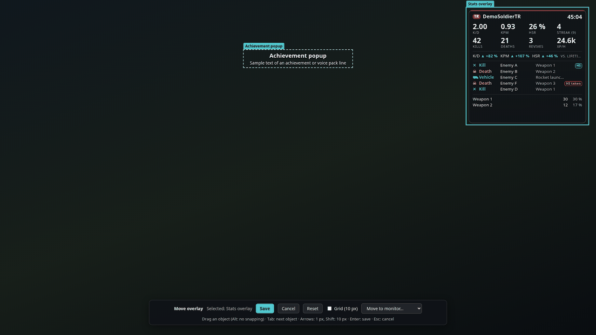
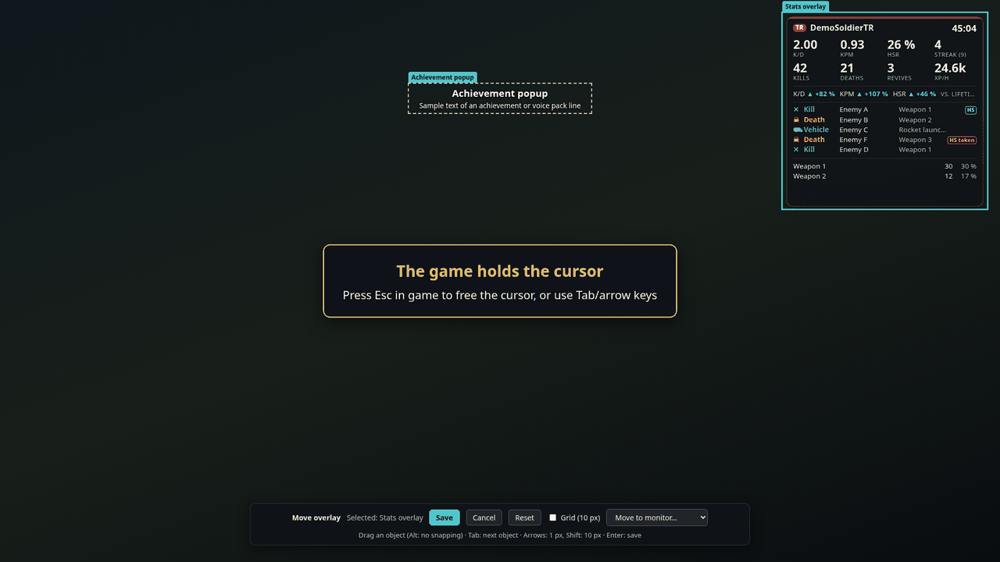

# Overlay and Move Mode

## Overlay

A transparent, borderless, always-on-top and click-through window over the
game:

- blocks and presets (Minimal/Streamer/Full), three styles – **Card**
  (recommended), **Slim** (flat, no frame) and **Text only** (outline instead of
  a panel) –, size S/M/L/XL or automatic by monitor height;
- two separately positioned objects: the stats overlay and the
  achievement/voice pack pop-up (the pack image unchanged with its alpha
  channel, text with shadow, fade in/out, adjustable duration);
- optional block “Squad top 3”, see
  [Squad and Outfit Tracking](Squad-and-Outfit-Tracking);
- position by anchor, offset and “Reset position” on the Overlay page, or
  directly over the game with the move layer; always fully on the monitor.

## Move layer (Ctrl+F2)

**Ctrl+F2** (or `ps2-tracker --toggle-edit`, or *Overlay → Move mode*) puts a
dimmed layer over the whole monitor of the game. On it, the stats overlay and
the pop-up are frames at their real size and position, with their real content.

- **Drag** with the mouse; the objects snap to the monitor edges and centre and
  to the other object (hold **Alt**: free), optionally a 10 px grid. The
  position in pixels is shown under the frame.
- **Keyboard** (always works): **Tab** switches the object, **arrow keys** 1 px,
  **Shift+arrows** 10 px, **Enter** or **Ctrl+F2** saves, **Esc** discards. The
  bar at the bottom also has *Save*, *Cancel*, *Reset* and *Move to monitor…*.
- **Finishing always works**: **Ctrl+Esc**, on Windows **Ctrl+Shift+F2** (key
  “Finish move mode”, changeable on the Overlay page) saves and ends – as a
  global hotkey for the whole move session, also while the game holds the
  cursor. Also: tray menu *Finish move mode*, the button on the Overlay page or
  the banner in the main window, `ps2-tracker --finish-move`, and by itself
  after 5 minutes without input (saves; adjustable or switchable off on the
  Overlay page). Discarding only with *Cancel* or Esc without a pointer grab.
- **If the game holds the mouse pointer** (mouse look), the layer shows *“The
  game holds the cursor”*: **press Esc in the game** (opens the game menu and
  releases the pointer) or work with Tab/arrow keys.
- Only when saving are the real windows moved, **once** (with a position check
  in the log). Positions are stored relative to the monitor (corner + offset).

**KDE/KWin and Ctrl+F2:** KWin often binds Ctrl+F2 to “Switch to Desktop 2”.
Then the app cannot register the key: the log shows
`hotkey registered failed hotkey=Ctrl+F2 …`, Settings and the Overlay page warn,
and the move layer suggests Ctrl+Escape or the tray menu. Free the key in the
KDE system settings (*Keyboard → Shortcuts → KWin*) or choose another key on the
Overlay page.

Technique: like the crosshair, the layer is an “on-screen display” window and
stays above the fullscreen game under KWin. Dragging happens inside the layer,
not through the window manager (KWin never moves OSD windows). The layer
requests the keyboard focus with `_NET_ACTIVE_WINDOW` and detects a pointer
grab with a short own `XGrabPointer` attempt. Log lines:
`move layer opened monitor=… focus=granted|denied pointer=free|grabbed`,
`move layer saved …` or `move layer cancelled`, then
`move layer finished via=hotkey|tray|button|cli|timeout`.

## KDE Plasma (Wayland)

Overlay and crosshair are separate, transparent Tauri/GTK windows.

### Why the app runs through XWayland

KWin orders windows in layers (`Window::belongsToLayer()` in
`kwin/src/window.cpp`):

`Above` (“Keep above others”) < `Notification` < `Active` (active fullscreen
window) < `Popup` < `CriticalNotification` < `OnScreenDisplay` < `Overlay`

A game in *Fullscreen Windowed* mode is an active fullscreen window and lies
**above** every “keep above” window. Only `CriticalNotification`,
`OnScreenDisplay` and `Overlay` are above it. A native Wayland window can choose
neither its position nor such a layer (GTK3/Tauri offer no layer shell); an X11
window through XWayland can set `_KDE_NET_WM_WINDOW_TYPE_ON_SCREEN_DISPLAY`.

That is why the app restarts itself once with `GDK_BACKEND=x11` in a Wayland
session (log: `backend="x11"`), sets the window type “on-screen display” for
crosshair and overlay (fallback `_NET_WM_WINDOW_TYPE_NOTIFICATION` for other
window managers) and maps the window once more. The windows take no focus and
stay click-through. The overlay has a fixed size (the measured size of its
content) and a position from anchor and offset; the log shows
`overlay placed: …` and `overlay position check requested=… actual=…`.

Switch off: untick *Settings → Appearance → Run windows through XWayland*
(`ui.x11_backend = false`) or set `PS2_TRACKER_WAYLAND=1`. Switch off only the
window type (diagnosis): `PS2_TRACKER_NO_OSD=1`.

### KWin window rule (recommended)

*System Settings → Window Management → Window Rules → Import* and load
`/usr/share/ps2-tracker/ps2-tracker.kwinrule` (in the repository
[`packaging/kde/ps2-tracker.kwinrule`](https://github.com/Elementary-Beginnings/ps2-tracker/blob/main/packaging/kde/ps2-tracker.kwinrule)).
The rule forces the **layer “On-screen display”** for overlay, pop-up and
crosshair (matched by window title), “Keep above others”, “Accept focus: no”,
and hides them from the taskbar, pager and window switcher. The rule property
“Layer” exists in KWin since at least 6.2. A KWin script is no alternative: in
the script API `layer` is read-only and `keepAbove` only lifts into `Above`.

### More

- **Transparency** needs a compositor; KWin always composites.
- **Click-through**: GTK input region; tao leaves a 1×1 pixel area at the top
  left clickable, which lies in the transparent border.
- **Hotkeys** under Wayland: see [Hotkeys](Hotkeys#kde-shortcuts-wayland).
- **HiDPI/fractional scaling**: window size and position in physical pixels;
  the log names monitor, scaling and window position on every change.

## OBS browser source

Enable *Settings → OBS browser source* and add a browser source in OBS for
`http://127.0.0.1:47823/` (bound to `127.0.0.1` only). It shows the same blocks
as the overlay, including the kill feed and “Squad top 3”.
