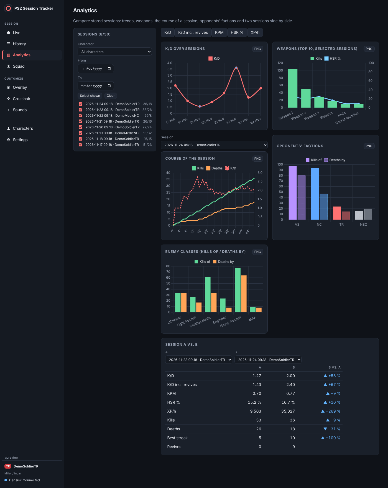
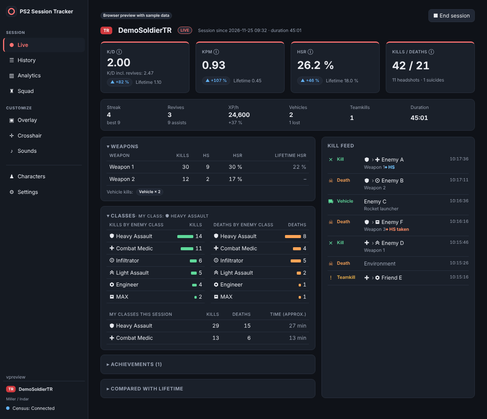
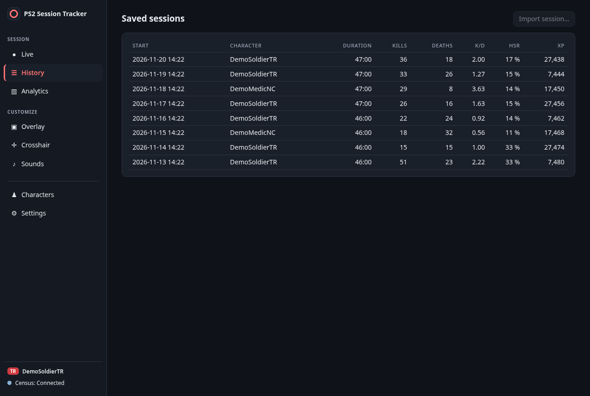

# Sessions, Analytics and Export

## Live session

- **Values:** kills, deaths, K/D, KPM, headshots/HSR, revives, assists, XP/h,
  teamkills, suicides, vehicle kills, kill streak and best streak, kills/HS per
  weapon.
- **K/D incl. revives** as in game: deaths you were revived from (experience 7
  “Revive”, 53 “Squad Revive”) do not count. Optionally as the big K/D on the
  live page (*Settings → Big K/D on the live page*), as an overlay/OBS block and
  in all exports; the true K/D stays visible next to it. A lifetime comparison
  exists only for the true K/D (Census keeps no lifetime K/D adjusted for
  revives).
- **Kill feed** in the app, overlay and OBS: kill green, death orange, teamkill
  yellow, own headshot “HS” cyan, headshot taken “HS taken” coral, always with
  symbol and text (colour is never the only information, contrast checked by a
  test). Missing names are looked up later; without a name the reason is shown
  (Yourself, Environment, Looking up…, Unknown player).
- **Classes** (Infiltrator, Light Assault, Combat Medic, Engineer, Heavy
  Assault, MAX; NSO counts as the same classes): from the loadout IDs of Death
  and GainExperience events. The kill feed shows the class icon before the name
  (the victim's class for a kill, the attacker's for a death; optionally also
  your own class, *Overlay → Widgets → Show my class in the kill feed*). The
  collapsible section *Classes* on the live page shows kills and deaths by enemy
  class and your own classes of the session (kills, deaths, approximate time).
  The mapping loadout → class is built in
  (`crates/ps2-tracker-core/data/loadouts.json`); unknown IDs stay “–”.
  Sessions before data version 4 have no classes.
- **Comparison with lifetime values** (`characters_stat_history`,
  `characters_weapon_stat_by_faction`), also per weapon.
- **Several characters** (e.g. one per faction); automatic start at login or
  the first event, end at logout or after inactivity.
- **Achievements** as an own TOML rule set (multikill, streak, headshot series,
  revenge, vehicle kills …); own rules in `achievements.toml`
  (see [Getting Started](Getting-Started#configuration-and-data)).

## History

Sessions are stored in SQLite (schema version 3, session data version 4; old
databases are migrated at startup; a damaged file is moved aside and created
anew): list, detail view, export and import.

## Export

*History → Session*:

- **Excel** (.xlsx) with the sheets Summary, Kills, Deaths (with the columns
  *Enemy class* and *My class*), Classes, Weapons, Vehicles, Revives & Assists,
  Achievements and Timeline (series per minute) as real Excel tables with
  number, percent and date formats (UTC).
- **JSON** in the versioned format `ps2-tracker-session` (schema:
  [`docs/session-file.schema.json`](https://github.com/Elementary-Beginnings/ps2-tracker/blob/main/docs/session-file.schema.json)).
- **CSV** as a simple event list.

## Import

*History → Import session…*, only through the file dialog: JSON and Excel files
exported by the tracker. The session is also embedded as data in the .xlsx; if
a spreadsheet program saves the file again, that data is lost and the import
rejects the file with a notice. Checked are format, version, times, size
(25 MB) and list lengths; a session of the same character with the same start
time is not created twice.

## Analytics

Choose sessions by character and period (up to 50): charts of K/D, K/D incl.
revives, KPM, HSR and XP/h across sessions, weapon comparison, progress of one
session, enemy factions (faction colours), enemy classes and session A vs. B
with differences; dark/light; PNG export per chart. Charts use Chart.js 4
(canvas, no `eval`, the CSP stays `script-src 'self'`; loaded only when the page
is opened).

Sessions from versions before 0.2.0 (marked “basic”) contain only kills, deaths
and vehicles in the detail view; XP progress, revives/assists, achievements and
the enemies' faction are missing there.
