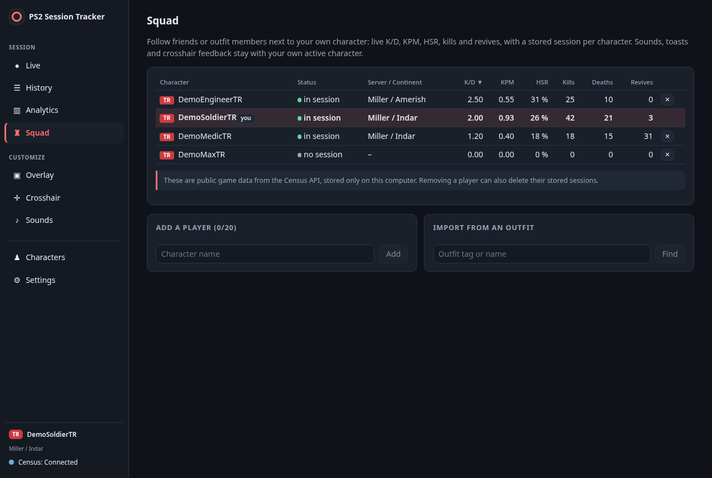
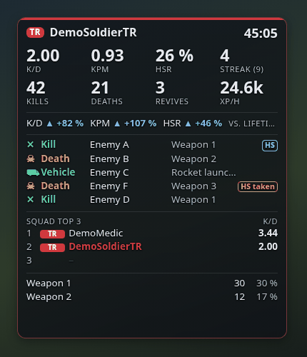
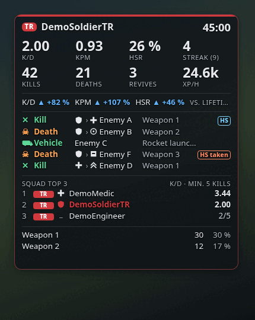

# Squad and Outfit Tracking

Follow friends or outfit members (up to 20) alongside your own characters.

## Squad page

- Live values per character: K/D, KPM, HSR, kills, revives, status, current
  class (last loadout seen, “–” without an event); sortable, own row
  highlighted.
- Column *Server / Continent*: last server and continent of the running
  session (names from Census).
- **Import from an outfit** by tag or name, optionally only online members.
- Stored sessions per character and a delete function.
- A new or removed member (also by outfit import) is subscribed or unsubscribed
  right away on the open event stream connection (`ESS subscription updated
  added=… removed=…` in the log); Squad page, overlay and OBS show it
  immediately.

Sounds, pop-ups and hit feedback still apply only to your own active
character. Squad data is public game data and stored only locally (see
[Permissions and Privacy](Permissions-and-Privacy#squad-data)).

## Overlay block “Squad top 3”

*Overlay → Widgets* (also in the OBS browser source): the three best characters
of the running sessions (own and squad) by K/D, kills or KPM, with faction
badge and class icon; the own row is marked.

- K/D and KPM need a minimum number of kills (default 5): characters below it
  are still listed, but after the others, sorted by kills, with a dimmed value
  “kills/minimum” (header “min. 5 kills”).
- Squad members appear even without an event; empty places (“–”) exist only
  when there are fewer than three characters.
- The block always has three rows, so the overlay keeps its size.
- Off by default; the Squad page points to it with a link.

