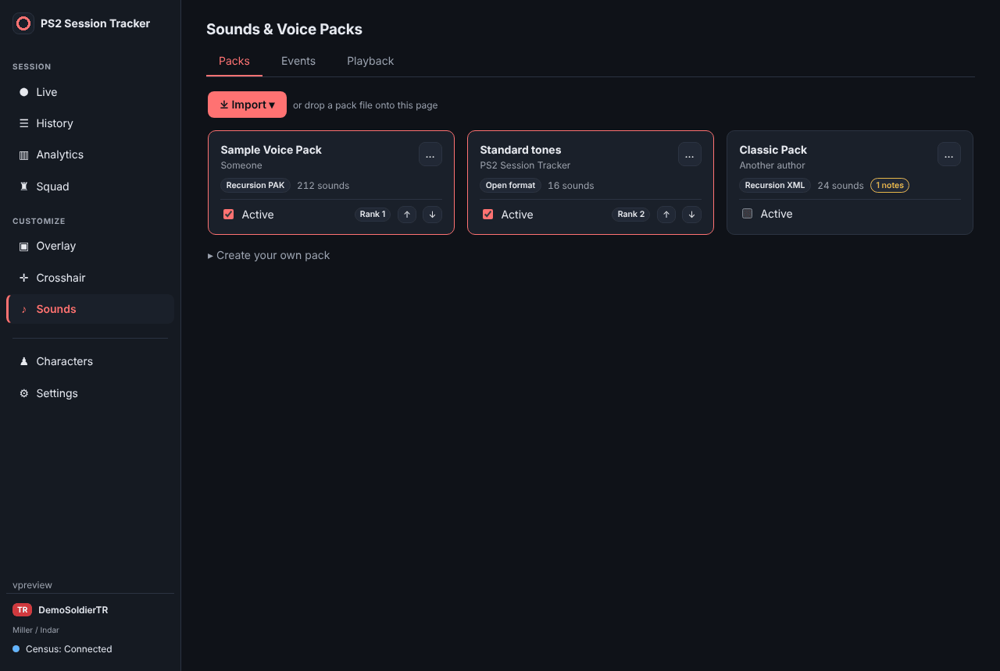
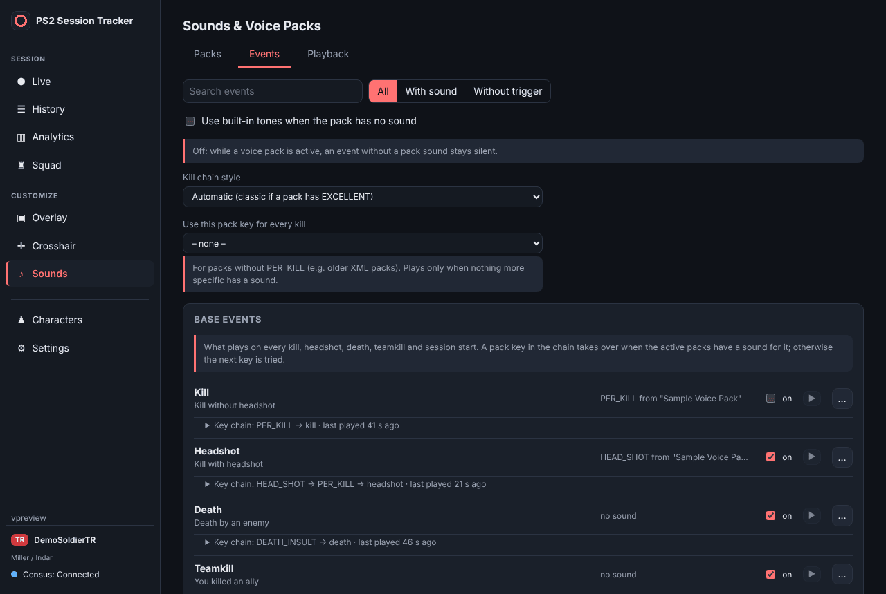
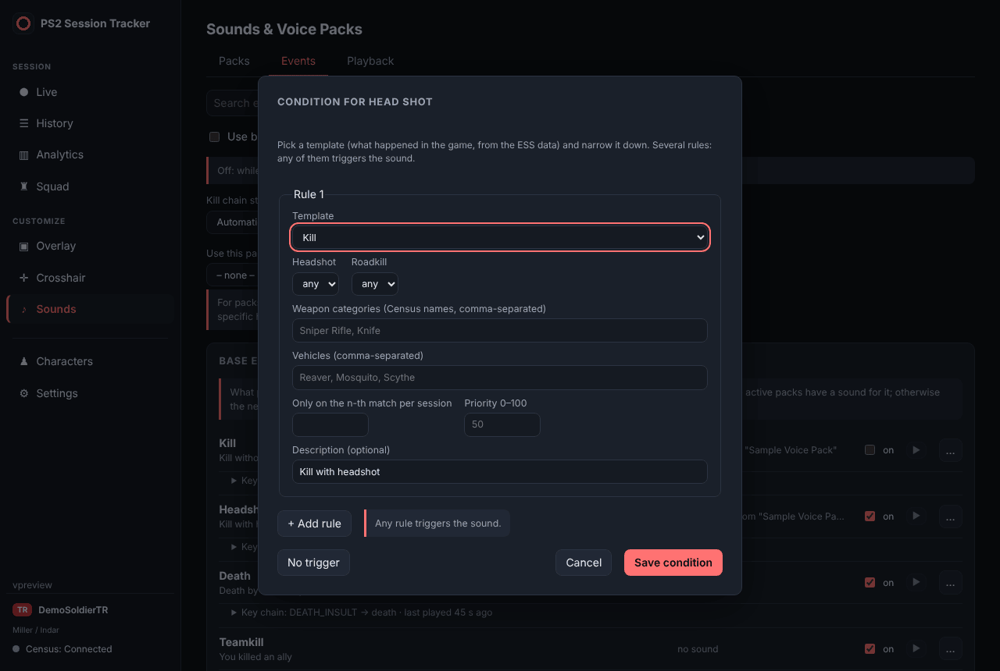

# Voice Packs

Sounds and voice lines on game events: an own open format and Recursion packs
(`.rtst_vpk`, three formats), priority queue, selectable output device,
conditions per event editable in the user interface. File formats, triggers and
all keys for pack authors: [Voice Pack Format](Voice-Pack-Format).

## Import

Folders, ZIPs and single `.rtst_vpk` files are imported (*Sounds → Packs →
Import*). Three Recursion formats are recognised:

| Format | Recognised by | Examples |
|---|---|---|
| XML (as of 2014) | text with `<NAME>` entries, sounds as files in the folder next to it | ArnoldVoicePack |
| SharpSerializer, binary | first bytes `02 01 04 52 6f 6f 74 01`, sounds embedded or as a list | Deadpool v2, C&C V6, Camikaze78 |
| protobuf (protobuf-net) | first bytes `0a …`, type names with `RecursionTracker.`, sounds embedded | ArnoldVoicePackBETA |

A .NET BinaryFormatter reader is included as a precaution. Packs are only read
(size and depth limits, no path outside the pack folder, foreign absolute paths
are ignored); the repository contains no Recursion files. A `.rtst_vpk`
imported on its own (XML or binary) takes the sound files it names from the
folder it lies in, e.g. Downloads: only audio files (recognised by their
content, at most 20 MB each) are copied into the library, anything else the
pack names is skipped. Packs made on Windows load on Linux too (backslashes in
paths, file names in a different upper/lower case than in the manifest). The Recursion format
was worked out solely from an own pack (clean room).

Supported audio: Ogg Vorbis, MP3, FLAC and WAV; Ogg Opus is recognised and
rejected with a notice.

## Which sound plays

A game event produces all matching events; the most specific match in the
active packs is played (by rank), the built-in default tones only as a last
resort.

| Game event | Keys (specific → general) |
|---|---|
| Kill | kill chain > kill streak > `ROAD_KILL`/`KNIFE_FIGHT`/`FIRST_BLOOD`/`REVENGE` … > `HEAD_SHOT` (headshot) > `PER_KILL` > own key “every kill” > default `kill`/`headshot` |
| Own death | `BEING_FARMED`/`DEATH_STREAK` > `DEATH_INSULT` > default `death` |
| Teamkill done | `TEAM_KILLER` > default `teamkill` |
| Killed by a teammate | `WHOSE_SIDE` > `PREVENT_FF` > default `teamkilled` |
| Session start | `SESSION_STARTED` > default `session_start` |

| Kill chain | Recursion classic | Unreal |
|---|---|---|
| 2 / 3 / 4 | `EXCELLENT` / `OUTSTANDING` / `SUPERB` | `DOUBLE_KILL` / `TRIPLE_KILL` / `MULTI_KILL` |
| 5 … 10 | `MULTI_KILL` … `HOLY_SHIT` | `MEGA_KILL` … `HOLY_SHIT_2` |

Style under *Sounds → Events → Kill chain style* (“Automatic” = classic if a
pack has `EXCELLENT`).

## Conditions

35 of the 96 Recursion keys have a preset; all others can be assigned under
*Sounds → Events* with “Choose a condition…” (template + parameters, no TOML).
The Events page shows the base events with their key chain and “last played”
at the top. Changed conditions are stored in `config.toml`
(`[voice.trigger_overrides]`); a whole own rule set goes into `triggers.toml`
(see [Getting Started](Getting-Started#configuration-and-data)).

Sounds, pop-ups and hit feedback apply only to your own active character, not
to squad members. Problems with audio devices:
[Troubleshooting and FAQ](Troubleshooting-and-FAQ#no-sound).
